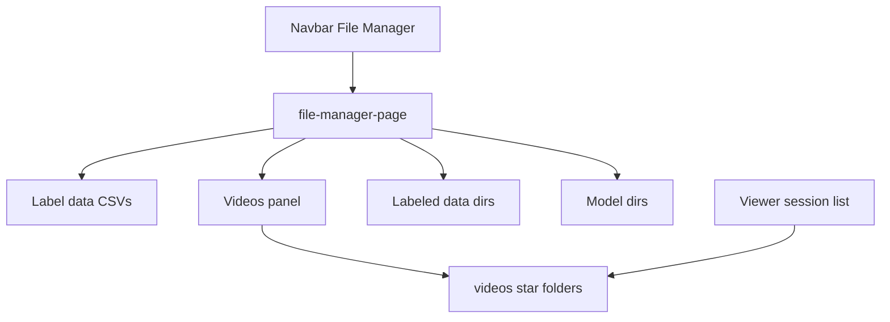

# File Manager screen

Continue on the existing `lpa-video-management` branch in [lightning-pose-app](lightning-pose-app). Do not commit unless asked. Update [feature_plans/lpa-video-management.md](feature_plans/lpa-video-management.md) so it describes this screen instead of the settings tab.

## Screen

Add route `project/:projectKey/files` in [app.routes.ts](lightning-pose-app/web_ui/src/app/app.routes.ts), title **File Manager**.

Add it after Viewer in the navbar ([app.component.ts](lightning-pose-app/web_ui/src/app/app.component.ts) `navLinks`) and as a fifth card on [project-home-page.component.ts](lightning-pose-app/web_ui/src/app/project-home-page/project-home-page.component.ts). The card figure uses a folder icon; no new photo asset.

Remove the **Videos** tab from [project-settings.component.ts](lightning-pose-app/web_ui/src/app/project-settings/project-settings.component.ts) and its template branch. Create-project is unchanged.

New page `web_ui/src/app/file-manager/file-manager-page`. A vertical stack of four DaisyUI cards, in this order:

1. **Label data** — CSV files
2. **Videos** — current settings Videos UI, moved here
3. **Labeled data** — directories under `labeled-data/`
4. **Models** — directories in the project model directory

No image or video playback. Each card has a **Validate files** button. Tables scroll inside the card (nested video folders can hold hundreds of files).

## Shared video discovery

The Viewer tooltip is wrong. [session.service.ts](lightning-pose-app/web_ui/src/app/session.service.ts) already calls `rglob` with `videos*/**/*.mp4`, which is why `videos`, `videos_test`, and `videos-for-each-labeled-frame/<session>/*.mp4` all show up. The settings page then keeps only the folders named `videos` and `videos_test` ([project-videos.component.ts](lightning-pose-app/web_ui/src/app/project-settings/project-videos/project-videos.component.ts) `PROJECT_VIDEO_FOLDERS`).

One rule, used by the Viewer, the File Manager, inference (`_session_to_videos` in [inference.py](lightning-pose-app/app_server/src/litpose_app/routes/inference.py)), and project stats ([project.py](lightning-pose-app/app_server/src/litpose_app/routes/project.py)):

- A video folder is a **direct child of the data directory** whose name starts with `videos`.
- Playable sessions are `videos*/**/*.mp4` under those folders (nested files stay).

Put the glob and the `name.startsWith('videos')` check in one TypeScript helper used by `SessionService` and the videos panel. Put the same prefix check in one Python helper used by `resolve_project_video`, inference, and project stats.

Rename and in-place transcode today reject anything outside `videos/` and `videos_test/` ([videos.py](lightning-pose-app/app_server/src/litpose_app/routes/videos.py) `PROJECT_VIDEO_DIRS`). Change that allowlist to the prefix rule so a file the panel lists can be processed in place, still inside that same folder.

The Viewer lists `.mp4` only. The videos panel keeps the current convertible extensions (`.mp4`, `.avi`, `.mov`, `.mkv`, `.webm`) inside those same folders, so Process still sees non-mp4 sources. Update the panel’s intro sentence, which still says only `videos/` and `videos_test/`.

Viewer info tooltip in [viewer-page.component.html](lightning-pose-app/web_ui/src/app/viewer/viewer-page/viewer-page.component.html):

- Multiview: `Searches videos*/**/*.mp4 (any data-directory folder whose name starts with videos) then groups by session prefix.`
- Single-view: the same sentence without the grouping clause.

## Videos panel

Move `project-videos` under `file-manager/` and drop the two-folder filter. Folder column stays the `videos*` directory name; the rest of the relative path stays in the filename column. Keep Refresh, Check all-intra, Process selected, Process all, and Rename.

**Validate files** on this panel re-runs the existing `parseVideoFilename` name check (already shown in the Name column) plus the folder-prefix check. It does not repeat the all-intra probe.

## Other panels

Each lists paths first (via existing `rglob` / model listing), then **Validate files** fills an issues column. Validation only reports; it does not rename or rewrite files.

**Label data.** Every `*.csv` under the data directory, excluding the model directory. Checks:

- Name: single-view `CollectedData.csv` or `CollectedData_test.csv`. Multiview `CollectedData_<view>.csv` or `CollectedData_<view>_test.csv` for a configured view.
- Format: the header rule already in [find_label_files.py](lightning-pose-app/app_server/src/litpose_app/routes/labeler/find_label_files.py) (3 header rows; each bodypart has `x` and `y`).
- Index paths look like `labeled-data/<dir>/<prefix><digits>.png|jpg`, stay inside the data directory, and the image exists. Show the first few missing paths plus a count.
- If the project has keypoint names, bodyparts that do not match are a warning.

**Labeled data.** One row per directory directly under `labeled-data/`, plus any loose file sitting in `labeled-data/` itself. Do not list every image. Checks:

- Directory name uses the same session / `session_view` rule as video filenames, without an extension.
- Children are image files matching the existing frame pattern (`img000123.png` / `.jpg`). Another subdirectory, or a non-image file, is an issue on that row.

**Models.** Directories the Models page already walks (up to two levels, [read_models_l1_from_base](lightning-pose-app/app_server/src/litpose_app/routes/models.py)), including directories that walk skips so they show up as unrecognized. Checks:

- Directory name matches the create-model filename rule (`^[a-zA-Z0-9][a-zA-Z0-9-._]+$`).
- Readable `config.yaml` (normal) or `ensemble.yaml` (EKS), not both, not neither.
- `train_status.json`, if present, is JSON with a `status` field.
- If `video_preds/` exists, it is a directory of prediction CSVs. CSV stems follow `session` or `session_view`. Unexpected nesting is an issue.

Label, labeled-data, and model checks run in one RPC, `POST /app/v0/rpc/validateProjectFiles`, with a `sector` argument, so CSV and YAML reads stay on the server.

## Tests

Name these in the feature plan:

- [test_videos.py](lightning-pose-app/app_server/tests/routes/test_videos.py) `test_resolve_project_video_accepts_any_videos_prefix_dir`: a nested file under `videos-for-each-labeled-frame/` is accepted; a file whose top folder does not start with `videos` is rejected. This is the regression for the old two-folder allowlist.
- The moved videos component spec: a multiview name without `_` is still flagged, and a listed path `videos-for-each-labeled-frame/session/clip.mp4` is kept.
- One pytest on the new RPC: a `CollectedData_<view>.csv` with a bad header is reported, and a well-formed one is not.

## Verify

With the dev app open, confirm the navbar reaches File Manager, settings no longer has Videos, the videos panel lists a `videos*` folder other than `videos/` (for example `videos_test`), Validate files reports a result on each panel, and the Viewer info tooltip matches the new sentence.
