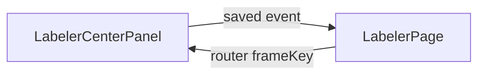

# Fix Labeler "Save and next" last-frame bug

## How this flow works (for orientation)

The Labeler splits responsibilities across two components:



1. **Frame list** lives on [`labeler-page.component.ts`](lightning-pose-app/web_ui/src/app/labeler/labeler-page.component.ts) as `labelFileData` (all frames in the left sidebar). Current frame comes from the URL query param `frameKey` → `selectedFrame`.

2. **Within a frame**, multiview projects have several `frame.views`. [`labeler-center-panel.component.ts`](lightning-pose-app/web_ui/src/app/labeler/labeler-center-panel/labeler-center-panel.component.ts) tracks `selectedView`.

3. **"Save and next"** (`shouldContinue: true`) in `handleSaveClick`:
   - Saves via `sessionService.saveMVFrame`
   - If there is a **next view** in the same frame → switch view locally (do not change `frameKey`)
   - Else emit `saved` with `shouldAdvanceFrame: true` → parent navigates to the next frame

4. **Parent** `handleSaved` updates local `labelFileData` (mark saved / remove on delete), then navigates to the next frame when `shouldAdvanceFrame` or `deletion` is set.

## Root cause

In [`handleSaved`](lightning-pose-app/web_ui/src/app/labeler/labeler-page.component.ts) (lines 168–171):

```ts
const nextFrameIndex = Math.min(
  data.deletion ? currentFrameIndex : currentFrameIndex + 1,
  this.labelFileData()!.length - 2,  // wrong for save-and-next
);
```

The cap `length - 2` never allows index `N-1` (last frame). From second-to-last you stay put; from last you jump to second-to-last. That cap was likely intended only for **delete-at-end** (pre-delete index becomes out of range after filtering).

## Fix

### 1. Correct next-frame index in `handleSaved`

Branch deletion vs advance instead of one shared `length - 2` cap:

- **Save and next:** use `currentFrameIndex + 1` on the post-update list; if `undefined` (already last), do not navigate.
- **Deletion:** after removing the frame, select the frame now at `currentFrameIndex` (the old next), clamped with `Math.min(currentFrameIndex, frames.length - 1)` so deleting the last frame lands on the new last.

Compute `currentFrameIndex` before the `labelFileData.update`, then resolve `nextFrameKey` from the updated list.

### 2. Disable "Save and next" when there is nowhere to go

Keep plain **Save** on existing `isSaveDisabled()` (no frame / saving / no keypoint changes).

Add a separate disable for **Save and next**:

- Pass `[hasNextFrame]` from the page: `selectedFrame` index `< labelFileData.length - 1`.
- In the center panel, also treat “has next view” (same logic as `handleSaveClick`: next entry in `frame.views`).
- Disable when `isSaveDisabled()` **or** (`!hasNextView && !hasNextFrame`).
- Update `saveAndContinueTooltip` for the last-frame case (e.g. “Already on last frame.”), while keeping “No changes to save.” when unchanged.

This preserves multiview: on the last frame you can still Save and next through remaining views; only the last view of the last frame is disabled (in addition to the no-changes case).

Touch points:

- [`labeler-page.component.ts`](lightning-pose-app/web_ui/src/app/labeler/labeler-page.component.ts) — fix `handleSaved`; add `hasNextFrame` computed
- [`labeler-page.component.html`](lightning-pose-app/web_ui/src/app/labeler/labeler-page.component.html) — pass `[hasNextFrame]`
- [`labeler-center-panel.component.ts`](lightning-pose-app/web_ui/src/app/labeler/labeler-center-panel/labeler-center-panel.component.ts) — `hasNextFrame` input, `isSaveAndNextDisabled`, tooltip
- [`labeler-center-panel.component.html`](lightning-pose-app/web_ui/src/app/labeler/labeler-center-panel/labeler-center-panel.component.html) — bind disable on Save and next only

### 3. Test

No coverage today for this path. Add focused unit tests on `handleSaved` (or a small extracted helper if that keeps the page test lighter):

- Advance from `N-2` → last frame key
- Advance from last → no navigation
- Delete last frame → navigate to previous remaining frame

## Out of scope

No feature-plan file (bugfix). No PR/commit unless you ask.
