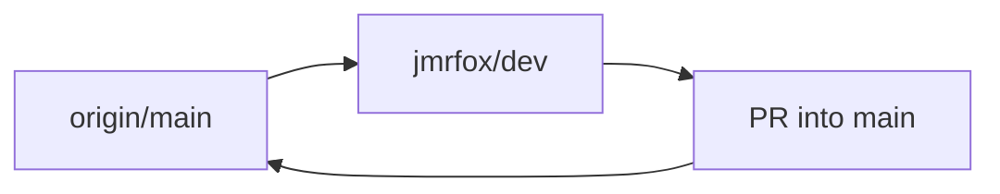

# LPA personal branch and PR workflow

You already have write access to [paninski-lab/lightning-pose-app](https://github.com/paninski-lab/lightning-pose-app) (not admin). You do **not** need a fork. Push a branch to `origin` and open a PR into `main`.

You are currently on **`main`**, in sync with `origin/main`, with uncommitted setup work:

- Modified: [Procfile.dev](lightning-pose-app/Procfile.dev), [development.md](lightning-pose-app/development.md)
- Untracked: [scripts/create_github_release.sh](lightning-pose-app/scripts/create_github_release.sh)

Those changes should live on your personal branch, not on `main`.

## Daily setup (same repo)



1. From a clean-enough tree on `main`:

   ```bash
   cd /teamspace/studios/this_studio/lightning-pose-app
   git checkout -b jmrfox/dev
   git push -u origin jmrfox/dev
   ```

   Branch name `jmrfox/dev` is the default; we can use another name if you prefer.

2. **Stay on `jmrfox/dev` for all LPA edits.** Commit and `git push` there. Do not `git push origin main`.

3. When a batch is ready to land:

   ```bash
   git push origin jmrfox/dev
   gh pr create --base main --head jmrfox/dev --title "..." --body "..."
   ```

   CI (lint + tests) already runs on PRs ([.github/workflows/lint.yml](lightning-pose-app/.github/workflows/lint.yml), [tests.yml](lightning-pose-app/.github/workflows/tests.yml)). After review/merge on GitHub, the PR closes.

4. **After each merge**, sync the long-lived branch so it does not drift (especially if the org **squash-merges**):

   ```bash
   git checkout main
   git pull origin main
   git checkout jmrfox/dev
   git merge main    # or: git reset --hard origin/main if you squash-merged and have no extra local commits
   git push origin jmrfox/dev
   ```

   Next batch: more commits on `jmrfox/dev`, then a **new** PR.

You cannot turn on “require PRs to `main`” (that needs admin). The admin can set branch protection; you just follow the workflow.

## First PR: the setup commits already sitting on disk

On `jmrfox/dev`, commit (when you ask to commit):

- `scripts/create_github_release.sh` (executable)
- `development.md` (Studio note + release steps)
- `Procfile.dev` (local `./node_modules/.bin/ng` so honcho’s `/bin/sh` finds Angular)

Then push and open the first PR into `main`. Leave [`.lightning_studio/on_start.sh`](.lightning_studio/on_start.sh) **out** of the LPA repo (Studio-only).

## How this interacts with releases

[create_github_release.sh](lightning-pose-app/scripts/create_github_release.sh) still requires a **clean `main` that matches `origin/main`**. That is correct: PyPI publishes from a GitHub Release whose tag must match `app_server/pyproject.toml` on the tagged commit.

Release loop:

1. On `jmrfox/dev`: bump version, README notes, any code.
2. PR into `main` and merge.
3. `git checkout main && git pull`
4. `./scripts/create_github_release.sh`

Do not tag or run the release script from `jmrfox/dev`.

Add a short “Branches and PRs” note to [development.md](lightning-pose-app/development.md) so the release section says “version bump lands via PR, then release from `main`.”

## Lightning Pose

Same org write access. Use the same pattern there only when you change LP (`jmrfox/dev` or a one-off branch + PR). Day-to-day LPA work does not require an LP branch.
