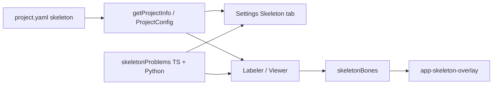

# LPA skeleton implementation review

## Scope reviewed

- **Branch:** `lpa-skeleton` in [lightning-pose-app](lightning-pose-app) (~20 modified files + new skeleton modules; all changes currently **unstaged**).
- **Spec:** [feature_plans/lpa-skeleton.md](feature_plans/lpa-skeleton.md).



## What looks solid

| Area | Assessment |
|------|------------|
| **Persistence** | `skeleton: Any` on [`ProjectConfig`](lightning-pose-app/app_server/src/litpose_app/datatypes.py) / [`ProjectInfo`](lightning-pose-app/app_server/src/litpose_app/routes/project.py) and frontend [`ProjectInfo`](lightning-pose-app/web_ui/src/app/project-info.ts) avoids rejecting the whole `project.yaml` on bad hand edits. Save-time guard via [`_reject_invalid_skeleton`](lightning-pose-app/app_server/src/litpose_app/routes/project.py) matches the plan. |
| **Validation parity** | [`skeleton.py`](lightning-pose-app/app_server/src/litpose_app/skeleton.py) and [`skeleton-validity.ts`](lightning-pose-app/web_ui/src/app/components/skeleton-overlay/skeleton-validity.ts) implement the same rule catalog (self-pair, unknown names, undirected duplicate, bad shape, empty/null valid). |
| **Drawing** | [`skeleton-bones.ts`](lightning-pose-app/web_ui/src/app/components/skeleton-overlay/skeleton-bones.ts) handles missing/NaN ends, `visible: false`, per-`modelKey` grouping; Viewer only passes keypoints from `keypointsShown()` per tile, so unchecked names never get endpoints. |
| **Labeler drag/placement** | [`displayedSegments`](lightning-pose-app/web_ui/src/app/keypoint-container/keypoint-container.component.ts) swaps the moving endpoint to `crosshairPosition()` when `selectedKeypointIsMoving()` (drag **or** `editMode()`), matching the plan. |
| **Layering** | Skeleton SVG is before the `@for` keypoint nodes ([`keypoint-container.component.html`](lightning-pose-app/web_ui/src/app/keypoint-container/keypoint-container.component.html)); spec asserts document order in [`keypoint-container.component.spec.ts`](lightning-pose-app/web_ui/src/app/keypoint-container/keypoint-container.component.spec.ts). |
| **View options** | Shared [`SkeletonViewOptionsComponent`](lightning-pose-app/web_ui/src/app/components/skeleton-view-options/skeleton-view-options.component.ts): toggle off hides sliders; `invalid` disables toggle, forces unchecked UI, hides sliders. Persistence on both view-option services matches the plan keys. **Thickness range is changing** (see below)—current code matches the old spec (1–8 integer). |
| **Settings UX** | Presentational [`ProjectSkeletonComponent`](lightning-pose-app/web_ui/src/app/project-settings/project-skeleton/project-skeleton.component.ts): add blocked when invalid; patch-only skeleton on edit when `skeletonDirty`; create omits `skeleton` when empty. |
| **Tests** | Plan’s spec list is implemented (validity, bones, overlay stroke, container z-order, view-options, backend round-trip/reject/no-key). |

## Issues worth fixing (ordered by impact)

### 1. Computed skeleton state does not track `projectContext()` (reactivity footgun)

[`drawableSkeletonPairs`](lightning-pose-app/web_ui/src/app/labeler/image-label-widget/image-label-widget.component.ts) and the same pattern in [`viewer-center-panel`](lightning-pose-app/web_ui/src/app/viewer/viewer-center-panel/viewer-center-panel.component.ts) read the **legacy getter** `projectInfoService.projectInfo`, which is **not** a signal.

[`skeletonInvalid`](lightning-pose-app/web_ui/src/app/labeler/labeler-center-panel/labeler-center-panel.component.ts) / [`viewer-page`](lightning-pose-app/web_ui/src/app/viewer/viewer-page/viewer-page.component.ts) do the same.

Elsewhere the app correctly uses `projectContext()?.projectInfo` (e.g. multiview check in labeler-center-panel). After [`reloadProjectInfo`](lightning-pose-app/web_ui/src/app/project-info.service.ts) / `storeProjectInfo`, `projectLoadedSubject` updates `projectContext()`, but these computeds **will not re-run** unless the component is destroyed and recreated.

**Typical navigation (Settings → Labeler) masks this** because components remount. It breaks if project info updates in-session without remounting (e.g. future live reload, or keeping Labeler alive under a parent route).

**Fix (small):** In each computed, read skeleton and keypoint names from:

```typescript
const info = this.projectInfoService.projectContext()?.projectInfo;
```

so Angular tracks the `projectContext` signal.

### 2. `skeletonDirty` not cleared after successful save

[`handleSaveClick`](lightning-pose-app/web_ui/src/app/project-settings/project-settings.component.ts) never sets `skeletonDirty` back to `false` after `updateProjectConfig`. The Save button stays enabled because:

```html
(!projectInfoForm.dirty && !skeletonDirty()) || ...
```

**Fix:** After a successful save in edit mode, `skeletonDirty.set(false)` and optionally refresh `skeletonValue` from `reloadProjectInfo` (which already runs inside `updateProjectConfig`).

### 3. Misleading post-save copy

Settings still shows: *"Saved. Refresh the page for changes to take effect."* after skeleton work that now **reloads** project info via RPC. Bones can appear without a full refresh once reactivity (item 1) is fixed.

**Fix:** Narrow or update the message (or drop “refresh” for metadata-only saves).

### 4. Invalid hand-edited skeleton: UI cannot clear malformed entries

[`rows()`](lightning-pose-app/web_ui/src/app/project-settings/project-skeleton/project-skeleton.component.ts) only displays `isNamePair` entries. If `project.yaml` has a non-list skeleton or malformed pairs mixed with good data, the user sees errors and **Save is disabled**, but cannot remove bad rows from the UI (only fix on disk). This matches “show what is wrong” but is a rough edge; acceptable if documented, or improve later with a “Reset skeleton” that sets `[]` when the user confirms.

## Design tweak: float bone thickness (0–5 px)

**Yes — this is straightforward.** SVG `stroke-width` already accepts fractional pixels; no backend or `project.yaml` changes. Only view-option UI, constants, and persistence.

| Current (per [lpa-skeleton.md](feature_plans/lpa-skeleton.md)) | Requested |
|----------------------------------------------------------------|-----------|
| `min=1`, `max=8`, `step=1`, default `2` | `min=0`, `max=5`, **float**, default **still `2`** |

**Implementation (when you execute the plan):**

1. **[`skeleton-validity.ts`](lightning-pose-app/web_ui/src/app/components/skeleton-overlay/skeleton-validity.ts)** — add shared bounds next to `DEFAULT_SKELETON_THICKNESS` (e.g. `MIN_SKELETON_THICKNESS = 0`, `MAX_SKELETON_THICKNESS = 5`, `SKELETON_THICKNESS_STEP = 0.05`) so Labeler/Viewer stay in sync.
2. **[`skeleton-view-options.component.ts`](lightning-pose-app/web_ui/src/app/components/skeleton-view-options/skeleton-view-options.component.ts)** — range input: `min="0"` `max="5"` `step="0.05"` (same granularity as bone opacity; use `step="any"` only if you want every float the browser emits). Label under slider: format for display (e.g. `1.25px` or one decimal) so `2.0000000001` does not appear.
3. **[`stored-number.ts`](lightning-pose-app/web_ui/src/app/components/skeleton-overlay/stored-number.ts)** (or a thin `storedSkeletonThickness` helper) — on read, `clamp` to `[0, 5]` so existing localStorage values **6–8** from the old slider map into **5** instead of drawing oversized strokes.
4. **`isSkeletonThicknessDefault`** — unchanged logic (`=== 2`); reset still sets `DEFAULT_SKELETON_THICKNESS`.

**Behavior notes:**

- **0 px** is valid: stroke invisible (useful with opacity for “bones off” without toggling show skeleton).
- No change to opacity slider (0–1, step 0.05).
- Overlay spec can keep asserting a numeric `stroke-width`; optional second case for a fractional value.

**Plan adherence:** This intentionally **supersedes** the thickness sentence in `lpa-skeleton.md`; everything else in the review still applies.

## Documentation updates (required in same work as thickness code)

These are **not optional**—ship them with the slider change so the written spec and release notes match behavior.

### [`feature_plans/lpa-skeleton.md`](feature_plans/lpa-skeleton.md)

- **Section:** View options (bullets under `showSkeleton` / persistence).
- **Replace** the thickness sentence on line ~101:
  - **From:** `Thickness is a pixel stroke width: default 2, range 1–8, step 1.`
  - **To:** `Thickness is a pixel stroke width: default 2, range 0–5, step 0.05.`
- Leave the opacity sentence unchanged (`default 1, range 0–1, step 0.05`).
- Per [lpa-git](.cursor/rules/lpa-git.mdc): feature-plan-only edits can land on `main` without a separate PR; if this ships on branch `lpa-skeleton` with app code, include the same file in that PR so the plan and implementation stay aligned.

### [`lightning-pose-app/CHANGELOG.md`](lightning-pose-app/CHANGELOG.md)

- **Section:** `### [2.4.2.1.dev0]` → **Skeleton** bullet (~line 13).
- **Expand** the user-facing sentence so thickness is explicit, e.g. append after “thickness and opacity in View options”:
  - `Bone thickness is 0–5 px (default 2, step 0.05); bone opacity is 0–1.`
- Or merge into one short clause if the bullet gets long—the goal is that a reader knows the **range** without reading the feature plan.
- Tests line at ~15 can stay as-is unless a spec is added for clamp/format display.

## Minor / optional improvements

- **Extra RPC on every Settings open:** [`refreshSkeletonFromServer`](lightning-pose-app/web_ui/src/app/project-settings/project-settings.component.ts) always calls `reloadProjectInfo` even when cache is fresh. Reasonable for hand-edited yaml; could skip when `projectInfo.skeleton` already matches last load timestamp if this becomes hot.
- **Duplicate validation logic (TS + Python):** Inherent drift risk. Mitigation already partial (TS catalog tests + one Python reject test). Optional: add a tiny shared JSON fixture both test suites import, or a single pytest that mirrors TS cases—only if you have seen drift before.
- **`stored-number.ts` location:** Lives under `skeleton-overlay/` but serves generic localStorage helpers for view-option services. Harmless; could move to `infra/` if you want cleaner imports.
- **Invalid skeleton + `showSkeleton` still true in localStorage:** Overlay renders with empty segments (harmless). Could pass `showSkeleton && !invalid` into [`app-keypoint-container`](lightning-pose-app/web_ui/src/app/keypoint-container/keypoint-container.component.html) to avoid mounting an empty SVG—micro-optimization.
- **DOM order vs plan:** Pixel grid SVG is **above** skeleton overlay when enabled; plan only required bones behind keypoints/dots. Unlikely user-visible issue.
- **`@for` track `$index` on segments:** Fine for small bone counts; use a stable key only if segments are ever reordered dynamically.
- **Create flow:** [`createNewProject`](lightning-pose-app/web_ui/src/app/project-info.service.ts) does not reload session `projectContext` (pre-existing pattern); low risk for skeleton-only create.

## Plan adherence checklist

| Requirement | Status |
|-------------|--------|
| Skeleton only in `project.yaml` | Yes |
| No LP training/export changes | Yes |
| Invalid load / valid save rules | Yes |
| Settings + wizard tab | Yes |
| Blue bones, thickness/opacity sliders | Yes |
| Viewer `name` + `modelKey` | Yes (`ViewerKeypoint`) |
| Multiview per-tile (no cross-tile lines) | Yes (separate containers per view) |
| Tests named in plan | Present |

## Recommended verification before merge

Run targeted suites (no code changes required for review):

```bash
cd lightning-pose-app/app_server && pytest tests/routes/test_project.py -k skeleton
cd lightning-pose-app/web_ui && npx ng test --no-watch --browsers=ChromeHeadless \
  --include='**/skeleton-*.spec.ts' \
  --include='**/keypoint-container.component.spec.ts' \
  --include='**/project-skeleton.component.spec.ts'
```

Manual smoke (Studio): open Settings → Skeleton, save pairs; Labeler/Viewer with [mirror-mouse-fused-tiny](LPProjects/mirror-mouse-fused-tiny); toggle view options; hand-edit `project.yaml` with a bad pair and confirm error + no draw.

## Suggested execution scope (single follow-up)

1. Switch skeleton computeds to `projectContext()?.projectInfo` (3–4 files).
2. Clear `skeletonDirty` after save + tweak success message.
3. Float bone thickness **0–5 px** (slider + clamp + display).
4. **Update** [`feature_plans/lpa-skeleton.md`](feature_plans/lpa-skeleton.md) and [`lightning-pose-app/CHANGELOG.md`](lightning-pose-app/CHANGELOG.md) (see Documentation updates above).
5. Run targeted tests (`verify-tests` todo).
6. (Optional) “Reset skeleton” or allow saving `[]` when invalid to recover from bad yaml without disk edit.

No architectural rework needed—the feature is in good shape for merge after reactivity, save-state, thickness, and doc updates.
