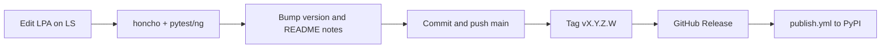

# Lightning Studio setup for LPA development and releases

## Current state

- Studio root is **not** a git repo. Work happens in the two clones: [lightning-pose-app](lightning-pose-app) (`main` @ `v2.3.0.3`) and [lightning-pose](lightning-pose) (`main` @ `v2.4.2`).
- [development.md](lightning-pose-app/development.md) assumes `conda create -n poseapp`. **LS allows only the default `cloudspace` env.** LP is already installed editable into `cloudspace` (`pip install -e .` succeeded). Do **not** try to create `poseapp`.
- **LPA is already installed editable with `[dev]`** in `cloudspace`. **`gh` is already installed.** Still pending: Node 26, Angular CLI, `web_ui` `npm install`, `pre-commit install`. Studio currently has Node **22**; LPA `.nvmrc` is **26**.
- Pushes and GitHub Releases use GitHub user **`jmrfox`**. **Org access is confirmed:** on both `paninski-lab/lightning-pose-app` and `paninski-lab/lightning-pose`, jmrfox has all permissions except **admin**. That is enough to push `main`, push tags, and `gh release create`. Admin is not required. Remaining: this Studio’s `gh` session must actually be logged in as jmrfox (`gh auth status` / `gh auth login` + `gh auth setup-git` if needed).
- PyPI already publishes when a **GitHub Release is published**, if the tag (with optional `v`) matches [app_server/pyproject.toml](lightning-pose-app/app_server/pyproject.toml) (`2.3.0.3` today). See [publish.yml](lightning-pose-app/.github/workflows/publish.yml). The missing piece is creating that GitHub Release without using the website.



## 1. Finish the LS-adapted install

Stay in `cloudspace`. From [lightning-pose-app](lightning-pose-app):

- Skip `pip install -e ".[dev]"` (already done). LP is **not** a pyproject dependency of LPA; the local editable LP install is what `litpose run_app` uses.
- Node: `nvm install` / `nvm use` from [web_ui/.nvmrc](lightning-pose-app/web_ui/.nvmrc) (`26`), then `npm install -g @angular/cli` and `cd web_ui && npm install`.
- `pre-commit install` in the LPA repo if not already (hooks only cover `app_server/src` and `app_server/tests`).
- Confirm `ffmpeg`, `nvidia-smi`, and `litpose --help`.
- **GitHub identity `jmrfox`:** Org write is already confirmed (push/maintain/triage/pull; not admin). On execute, only verify this machine’s `gh auth status` is **jmrfox**, then `gh auth setup-git` if `git push` is not using that credential. Direct push to `origin` on both clones is the intended path; no fork required.

**LS persistence:** [`.lightning_studio/on_start.sh`](.lightning_studio/on_start.sh) is empty. Add a small startup snippet: `nvm use 26` (or prepend that Node to `PATH`) so shells after a Studio restart match `.nvmrc`. Do not start honcho automatically.

**Ports:** [Procfile.dev](lightning-pose-app/Procfile.dev) already binds Angular with `--host 0.0.0.0` (needed on LS). Uvicorn is `:8080`. Use LS port forwarding / “Open port” for **4200** (primary UI) and 8080 if you hit the API directly.

**Tests that need extra runtime:**

- Backend: `cd app_server && pytest --ignore=tests/test_predict_wrapper.py` (same as CI).
- Frontend unit: Chrome/Chromium for `npx ng test --browsers=ChromeHeadless`. Install a headless Chrome if LS does not already have one.
- Playwright e2e (`npm run e2e`) is local-only and expects the app already on `:4200`. Optional later; not required for the first env pass.

## 2. Daily LPA loop on this machine

From the LPA repo root, with `cloudspace` + Node 26:

```bash
honcho -f Procfile.dev start
```

- UI: Angular `:4200` (proxies `/app` to uvicorn). Hot reload for TS and Python.
- Production-shaped check when needed: `./build_ui.sh` then `litpose run_app --host 0.0.0.0` (CLI lives in LP).

Lint: ruff via pre-commit; `npx ng lint` in `web_ui` before PRs (frontend is not in pre-commit).

**Docs split:** User-facing docs and ReadTheDocs live in **LP** ([docs/source/](lightning-pose/docs/source/), including `installation_guide.rst` Option B). App **release notes** live in [lightning-pose-app/README.md](lightning-pose-app/README.md) (currently lags tags: notes stop at `2.2.0.0` while the package is `2.3.0.3`). Treat README notes as the changelog you update on each LPA release; only touch the LP clone when the change is user-doc or core library.

## 3. Automate GitHub Release creation (local `gh` script only)

**Chosen approach:** You still bump version and README notes yourself, commit, and push. A local script then tags and creates the GitHub Release with `gh`. No new workflow that creates releases from tags. PyPI stays on existing `release: published` in [publish.yml](lightning-pose-app/.github/workflows/publish.yml).

**You set the version number every time.** The script never increments it. You edit `[project].version` in [app_server/pyproject.toml](lightning-pose-app/app_server/pyproject.toml) (`web_ui/package.json` stays `0.0.0`). The script only reads that string, tags `v$VERSION`, and creates the GitHub Release.

**LPA version convention `X.Y.Z.W`:** `X.Y.Z` is the Lightning Pose version this app release is built for; `W` is the LPA increment for that LP version, starting at `0`. Example: current LPA is `2.3.0.3` (third LPA release on LP `2.3.0`). Adopting current LP `2.4.2` is a new `X.Y.Z`, so LPA becomes `2.4.2.0`. A later app-only fix on that LP would be `2.4.2.1`. Tags match: `v2.4.2.0`.

Add **[lightning-pose-app/scripts/create_github_release.sh](lightning-pose-app/scripts/create_github_release.sh)** that:

- Reads `version` from `app_server/pyproject.toml`
- Requires a clean tree, `main` in sync with `origin/main`, and that README has a `### [VERSION]` notes heading
- Creates annotated tag `v$VERSION` if missing, pushes it
- Runs `gh release create "v$VERSION" --title "v$VERSION"` with notes sliced from that README section (curated notes, not `--generate-notes`)

Guardrails: refuse if tag version ≠ pyproject; do not `--force` tags; do not push if README notes are missing for that version.

This requires `gh` authenticated as **jmrfox** on this Studio. If you only `git push` a tag and skip the script, **no GitHub Release and no PyPI publish** until you run the script (or create the release on the website).

Document the loop in a short **RELEASING.md** (or a section in `development.md`): bump pyproject → README notes → commit/push → `./scripts/create_github_release.sh` → watch Actions for PyPI.

**Not in the first pass:** tag-triggered CI that creates the Release, auto-bumping versions, changelog generation from git, or changing PyPI trusted publishing.

## 4. Optional but useful LS/Cursor glue (small)

- Studio-local note (not committed to LPA unless you want it): “use `cloudspace`, not `poseapp`.”
- Cursor rule only if you want agents to default to LPA + `cloudspace` + Node 26; skip unless you ask for it.
- Leave [main.py](main.py) (`Hello, Lightning World!`) alone; it is Studio boilerplate.

## Out of scope unless you ask

- Forks/PRs vs direct `main` — **resolved:** jmrfox can push and release on both org repos; the release script assumes the version commit is on `origin/main` of `paninski-lab/lightning-pose-app`.
- Automating LP PyPI releases (different token-based [publish.yml](lightning-pose/.github/workflows/publish.yml)).
- Playwright/e2e or GPU `test_predict_wrapper.py` as a required gate.
