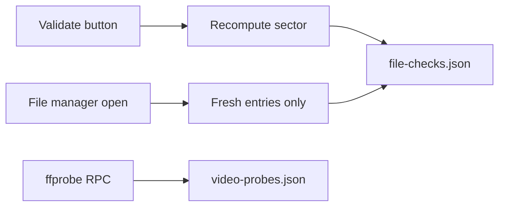

# Project cache

Spec: [feature_plans/lpa-project-cache.md](feature_plans/lpa-project-cache.md), except ignored video directories. Those stay in the process-global dict in `ignored_video_dirs.py` and are not part of this work. No migration and no edits to `projects.toml` or `project.yaml`. A missing or unreadable cache is empty.

## Shared store

New [app_server/src/litpose_app/project_cache.py](app_server/src/litpose_app/project_cache.py):

- Cache directory is `data_dir / ".project-cache"`. Refuse it when that path is a symlink or when a resolved file escapes `data_dir`.
- JSON read/write with `schema: 1`. Write via a temp file in the same directory and `os.replace`. Missing, corrupt, or wrong-schema files return empty.
- `identity_matches(path, size, mtime_ns, hash)`:
  1. `stat`. Size or `mtime_ns` mismatch means changed. Do not hash.
  2. If both match and `mtime_ns` has a fractional part, unchanged. Do not hash.
  3. If `mtime_ns` is an exact second, compare the stored hash. Full SHA-256 for text files. For videos, SHA-256 of the first 1 MiB concatenated with the last 1 MiB.

## File-manager checks

After `validateProjectFiles` recomputes a sector, store each `FileCheck` in `file-checks.json` with `size`, `mtime_ns`, `sha256`, `context` (`views`, `keypoints`), and label-CSV image existence deps. Directory rows (labeled-data sessions, model dirs) store directory `mtime_ns` plus sorted child names, and size/mtime of the small YAML/JSON files the validator already opened. Do not hash frames or prediction CSVs.

Add `cachedProjectFileChecks` (same request shape as validate). It returns only entries that still match context, stat, coarse-timestamp hash, and dep existence. Stale paths are omitted, not returned as OK.

Validate button in the four file-manager panels stays a full recompute. On panel `refresh()`, call the cached RPC and mark returned rows `checked`. Others stay "Not checked". Merge helper lives next to `keepCurrentPathOrder` in [web_ui/src/app/file-manager/file-listing.ts](web_ui/src/app/file-manager/file-listing.ts).

**Test:** `test_cached_ok_is_dropped_when_the_label_file_changes` in [app_server/tests/routes/test_validate_project_files.py](app_server/tests/routes/test_validate_project_files.py). Store an empty issue list, break the CSV header, and assert the cached read does not return that OK.

## Video probes

In [ffprobe](app_server/src/litpose_app/routes/ffprobe.py), use the project from `project_info_getter` (it is currently discarded). If the absolute path is an mp4 under the project data directory:

- Fresh `video-probes.json` entry: return the stored `FFProbeResponse` fields and skip `ffprobe`.
- Otherwise run `run_ffprobe`, store `size`, `mtime_ns`, `sample_sha256`, and the probe fields, then return them.

The videos page and the viewer both call this RPC, so both pick up the cache. Check-encoding still calls `ffprobe`; a fresh file returns immediately.

After an in-place transcode replaces the mp4, drop that probe entry in the transcode completion path so the next check cannot reuse the pre-conversion result if the timestamp did not move.

**Test:** `test_cached_all_intra_is_dropped_when_the_video_changes` in [app_server/tests/routes/test_ffprobe.py](app_server/tests/routes/test_ffprobe.py). Store `is_all_intra: true`, replace the mp4, and assert the route does not return the cached true.

## Drop entries when this app writes

Stat is the backstop. Also drop the matching cache entry in the same request for:

- Label CSV commit in [save_mvframe.py](app_server/src/litpose_app/routes/labeler/save_mvframe.py)
- Renames in [rename_project_files.py](app_server/src/litpose_app/routes/rename_project_files.py)
- Video transcode completion

A same-second rewrite can keep `mtime_ns`, which is the case the stat check misses.