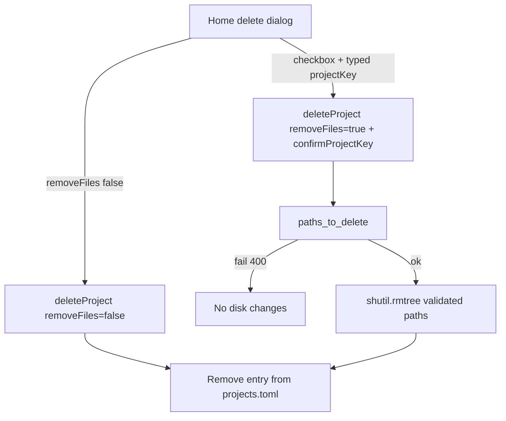

# Safe project delete

## Problem

[`delete_project`](lightning-pose-app/app_server/src/litpose_app/routes/project.py) calls `shutil.rmtree` on raw `data_dir` / `model_dir` from [`projects.toml`](file:///teamspace/studios/this_studio/.lightning-pose/projects.toml) with no guards. A mis-registered or overly broad path (e.g. studio workspace root) plus **Permanently delete files** can wipe far more than one project.

## Target behavior



| Action | Registry | Disk |
|--------|----------|------|
| **Remove** (default) | Unregister | No change |
| **Delete permanently** | Unregister after successful deletes | `rmtree` on validated paths only |

- **No trash** — keep immediate `rmtree` after validation passes.
- **No Lightning Studio env knob.**
- **`model_dir` outside `data_dir`:** delete both trees when each path passes the gate. If `model_dir` is inside `data_dir`, delete `data_dir` once. A parent directory (studio root, home, another project) never passes.

---

## 1. BUGS.md entry

Add an **open** section at the top of [BUGS.md](BUGS.md) (workspace root, matching existing format):

- **Status:** In progress on branch `fix/safe-project-delete` (create from `origin/main`).
- **Symptoms:** Delete project with “permanently delete files” removed the Lightning Studio workspace instead of a single project directory.
- **Cause:** `deleteProject` trusts `projects.toml` paths and calls `shutil.rmtree` without resolution, denylist, or project-root checks.
- **Fix (planned):** Central fail-closed validation + typed project-key confirmation in UI/API.
- **Tests:** Name the regression specs once implemented (see below).

---

## 2. Backend: fail-closed deletion gate (item 1)

The earlier draft only denied `/`, home, and `~/.lightning-pose`. That does **not** stop the failure mode: [`delete_project`](lightning-pose-app/app_server/src/litpose_app/routes/project.py) `rmtree`s `model_dir` with no `project.yaml` check, so a parent such as the studio workspace is deleted whenever it is stored as `model_dir` and is not exactly home. `project.yaml` only protects `data_dir`.

Add [`lightning-pose-app/app_server/src/litpose_app/project_deletion.py`](lightning-pose-app/app_server/src/litpose_app/project_deletion.py). Inject `home` and `cwd` as arguments (defaults `Path.home()` / `Path.cwd()`) so tests never point the live route at the real home directory.

### Shared: `reject_forbidden_root(path, *, home, cwd, lp_system_dir)`

Used for every path that will be deleted, and for paths accepted by create / register / update. Resolve with `Path.resolve()` first (follow symlinks; judge the real target).

Refuse when the resolved path:

- is missing, empty, or not absolute after resolve
- **equals or is an ancestor of** `home`, `cwd`, or `lp_system_dir` (this blocks `/`, the studio root when the server runs inside it, and `~/.lightning-pose`)
- equals or is an ancestor of the other path in this project (`model_dir` must not contain `data_dir`)

Descendants of those roots stay allowed (`…/LPProjects/my-project` is fine).

### Delete-only: `paths_to_delete(data_dir, model_dir, *, other_registered, home, cwd, lp_system_dir) -> list[Path]`

Returns the resolved directories to `rmtree`, in order. Extra rules:

- `data_dir` exists, is a directory, and `(data_dir / "project.yaml").is_file()`.
- If `model_dir` resolves inside `data_dir`, return only `data_dir` (one delete).
- If `model_dir` is outside `data_dir`: it must exist as a directory, pass `reject_forbidden_root`, **must not contain a `project.yaml` anywhere under it**, and must not contain another registered project's `data_dir` or `model_dir`. Return `[data_dir, model_dir]`.
- Neither path may contain another registered project's paths (`other_registered` = every other entry in `projects.toml`). Stops one project entry from deleting a sibling project's tree.

On any failure raise `HTTPException` 400. No disk change, no unregister.

### Wire-up in `delete_project`

- Add `confirmProjectKey: str | None = None` to `DeleteProjectRequest`.
- `removeFiles` false: unregister only, same as today.
- `removeFiles` true: `confirmProjectKey` must equal `projectKey` (case-sensitive, the tile label). Then `paths_to_delete`, then `shutil.rmtree` each returned path, then unregister. Validation failure leaves registry and disk unchanged.
- `Depends(deps.root_config)` supplies `LP_SYSTEM_DIR`.

### Register / create / update paths (narrower check)

Do **not** call `paths_to_delete` here. `CreateNewProject` mkdirs and writes `project.yaml` afterward, so requiring `project.yaml` up front would break project creation.

Call `reject_forbidden_root` on `data_dir` and on `model_dir` when set, from:

- [`CreateNewProject`](lightning-pose-app/app_server/src/litpose_app/routes/project.py)
- [`RegisterExistingProject`](lightning-pose-app/app_server/src/litpose_app/routes/project.py)
- [`UpdateProjectPaths`](lightning-pose-app/app_server/src/litpose_app/routes/project.py)

`RegisterExistingProject` still requires an existing `project.yaml` in `data_dir` (that is already how a real project is recognized). Existing bad `projects.toml` rows stay unregisterable; permanent delete fails closed.

---

## 3. Frontend: GitHub-style confirmation

Files: [`project-delete-dialog.component.html`](lightning-pose-app/web_ui/src/app/home-page/project-delete-dialog/project-delete-dialog.component.html), [`.ts`](lightning-pose-app/web_ui/src/app/home-page/project-delete-dialog/project-delete-dialog.component.ts), [`project-info.service.ts`](lightning-pose-app/web_ui/src/app/project-info.service.ts).

- When **Permanently delete files** is unchecked: unchanged UX; **Remove** / **Delete permanently** button enabled as today (unregister-only path).
- When checkbox is checked:
  - Show a text input below the checkbox (e.g. “Type the project name to confirm”).
  - Label: use **project key** (same string as `projectKey()` / tile name), matching GitHub repo name flow.
  - **Delete permanently** button disabled until `typedName === projectKey()` exactly.
  - Reset typed name when checkbox is unchecked (use `linkedSignal` or clear on toggle).
- Pass `confirmProjectKey` in RPC body when `removeFiles` is true ([`deleteProject`](lightning-pose-app/web_ui/src/app/project-info.service.ts)).
- Surface the server 400 `detail` in the error toast. On failure, do **not** close the dialog (`done` stays false). Today [`handleDelete`](lightning-pose-app/web_ui/src/app/home-page/project-delete-dialog/project-delete-dialog.component.ts) emits `done(true)` in the `catch`, which dismisses the dialog even when delete was rejected.

Update [`project-delete-dialog.stories.ts`](lightning-pose-app/web_ui/src/app/home-page/project-delete-dialog/project-delete-dialog.stories.ts): add a story with checkbox on + confirmation field visible.

---

## 4. Tests

### Backend — extend [`test_project_delete.py`](lightning-pose-app/app_server/tests/routes/test_project_delete.py)

- `removeFiles=true` without `confirmProjectKey` → **400**, files and registry unchanged.
- Wrong `confirmProjectKey` → **400**.
- `data_dir` under `tmp_path` with no `project.yaml` → **400**, directory and registry unchanged.
- Happy path: existing tests pass `confirmProjectKey` equal to the project key. `tmp_path` is not home, so normal fixture projects still delete.
- **Separate model_dir:** `data_dir` with `project.yaml` plus an external model directory under `tmp_path` (no `project.yaml` inside it) → both removed.
- **model_dir ancestor of data_dir**, **model_dir contains another project's path**, or **model_dir contains a nested `project.yaml`** → **400**, nothing deleted.

Do **not** point the HTTP test at the real `Path.home()` or the studio root. Cover those in [`test_project_deletion.py`](lightning-pose-app/app_server/tests/test_project_deletion.py) by passing fake `home` / `cwd` into the helper: path equal to home, path equal to cwd, path that is a parent of cwd, external `model_dir` that is a parent of another registered project. Assert the helper raises and does not return those paths.

### Frontend — new [`project-delete-dialog.component.spec.ts`](lightning-pose-app/web_ui/src/app/home-page/project-delete-dialog/project-delete-dialog.component.spec.ts)

- Permanent delete button disabled until project key typed correctly.
- Confirm calls `deleteProject(key, true)` with `confirmProjectKey` only when enabled (mock `ProjectInfoService` / `RpcService`).
- Unregister path: checkbox off, delete works without typed name.

Run:

```bash
cd lightning-pose-app/app_server && pytest tests/routes/test_project_delete.py tests/test_project_deletion.py
cd lightning-pose-app/web_ui && npx ng test --no-watch --browsers=ChromeHeadless --include=**/project-delete-dialog.component.spec.ts
```

---

## 5. Branch and changelog

- Branch: `fix/safe-project-delete` from `origin/main` (not `jmrfox/dev`, not `lpa-video-management`).
- The checkout is currently `lpa-video-management` with unrelated local edits (`find_label_files.py` and untracked files). Create the branch without bringing those changes along (`git stash -u` or a worktree from `origin/main`).
- One-line Unreleased note in [CHANGELOG.md](lightning-pose-app/CHANGELOG.md). Do not commit unless asked.

---

## Out of scope

- Trash / soft delete.
- `LITPOSE_*` Studio-only disable flag.
- `listProjects` `deletable: bool` preview field (can add later if UI should hide checkbox for legacy bad paths).
