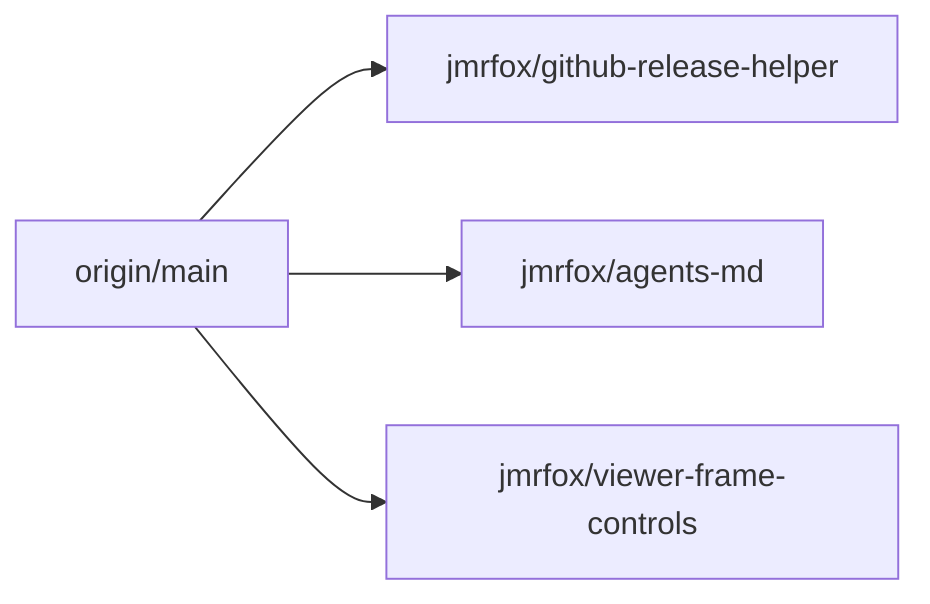

# Split LPA changes into topic PRs

Close [PR #112](https://github.com/paninski-lab/lightning-pose-app/pull/112) without deleting `jmrfox/dev`. Cut three branches from `origin/main` and cherry-pick the existing topical commits. Leave `jmrfox/dev` as-is (playground); do not force-push it.



## 1. Close the mixed PR

```bash
gh pr close 112 --repo paninski-lab/lightning-pose-app \
  --comment "Closing to split into topic PRs. Work remains on jmrfox/dev."
```

Confirm a clean working tree in [lightning-pose-app](lightning-pose-app) first (stash if needed). `git fetch origin`.

## 2. Release helper PR (docs + script + workflow section)

Branch: `jmrfox/github-release-helper` from `origin/main`.

Cherry-pick `d77099b` then `76c6c28` (release script, Procfile `ng` path, existing [development.md](lightning-pose-app/development.md) edits).

Then rewrite the existing **Branches and pull requests** section in [development.md](lightning-pose-app/development.md) (currently lines 103–122). Keep it in place; do not add a second workflow section. Write it for any contributor — no `jmrfox`, no personal playground branch, no machine-specific notes. Cover:

- Do not push `main`.
- One short-lived branch per goal, created from up-to-date `origin/main` (generic example like `fix/foo` or `feature/bar`).
- Open a PR from that branch into `main`; delete the branch after merge.
- If the PR was squash-merged, sync local `main` with `git pull` before starting the next branch. Do not document a long-lived personal integration branch.

Tweak the later release steps that say “On your personal branch” so they mean the feature/fix branch for that version bump.

Push and `gh pr create --base main --head jmrfox/github-release-helper`.

## 3. Agent docs PR

Branch: `jmrfox/agents-md` from `origin/main`.

Cherry-pick `01e1c6a` then `c196dfc` so `AGENTS.md` lands **and** `.cursor/` is not tracked.

Follow-up commit on this branch: update the Git bullet in [AGENTS.md](lightning-pose-app/AGENTS.md) to match per-goal branches (generic, no `jmrfox/dev`) and point at `development.md` for the full workflow.

Push and open PR into `main`.

## 4. Viewer PR

Branch: `jmrfox/viewer-frame-controls` from `origin/main`.

Cherry-pick `96adcbf` only. Push and open PR into `main` (reuse the Viewer-focused summary/test plan from #112, omit docs/gitignore).

These three PRs are independent (no shared files after the docs split). Open all three.

## Out of scope

- Do not reset or force-push `jmrfox/dev` until the topic PRs have merged.
- Do not merge the PRs unless you ask.
