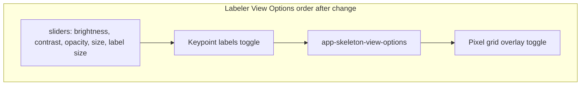

# View options layout tweaks

## Context

- **Labeler View Options** live in [`labeler-center-panel.component.html`](lightning-pose-app/web_ui/src/app/labeler/labeler-center-panel/labeler-center-panel.component.html) inside the right-hand panel accordion.
- **Viewer View Options** use the same skeleton block in [`viewer-page.component.html`](lightning-pose-app/web_ui/src/app/viewer/viewer-page/viewer-page.component.html).
- **Show skeleton** UI is centralized in [`skeleton-view-options.component.ts`](lightning-pose-app/web_ui/src/app/components/skeleton-view-options/skeleton-view-options.component.ts) (inline template). Fixing it once updates both Labeler and Viewer.

**Existing toggle pattern** (e.g. Keypoint labels in Labeler):

```html
<div class="flex items-center gap-2 pt-2">…label row…</div>
<div class="pl-2 flex items-center">
  <input type="checkbox" class="toggle …" />
</div>
```

**Current Show skeleton** puts the toggle on the same `flex items-center` row as the label (lines 21–48), which is why it sits to the right of the text.



## 1. Move pixel grid to end (Labeler only)

In [`labeler-center-panel.component.html`](lightning-pose-app/web_ui/src/app/labeler/labeler-center-panel/labeler-center-panel.component.html):

- **Remove** the pixel grid block from its current position (between “Keypoint label size” and “Keypoint labels”, ~lines 442–452).
- **Insert** that same block **after** the closing `</app-skeleton-view-options>` (~line 476), so it is the last item in the View Options list.

No TypeScript or service changes (`enablePixelGrid` in [`labeler-view-options.service.ts`](lightning-pose-app/web_ui/src/app/labeler/labeler-view-options.service.ts) stays as-is).

## 2. Show skeleton: label row + toggle below (Labeler + Viewer)

In [`skeleton-view-options.component.ts`](lightning-pose-app/web_ui/src/app/components/skeleton-view-options/skeleton-view-options.component.ts) template:

- **Label row:** keep `flex items-center gap-2 pt-2` with the existing skeleton SVG + “Show skeleton” text only. Move the invalid message out of this row (see below).
- **Toggle row:** add `div.pl-2.flex.items-center` with the checkbox (`toggle toggle-sm`, same bindings: `invalid()` disables and forces unchecked).
- **Invalid state:** show `Skeleton definition is invalid.` in a small row under the toggle (e.g. `pl-2 text-error text-xs`) when `invalid()`, instead of inline beside the toggle.

Bone thickness/opacity sections below stay unchanged (already use label row + `pl-2` control row).

## 3. Changelog and verification

- Add a one-line bullet under the existing `[2.4.2.3.dev0]` entry in [`CHANGELOG.md`](lightning-pose-app/CHANGELOG.md) (View Options ordering + skeleton toggle layout).
- **Manual check:** Labeler and Viewer → View Options: pixel grid is last in Labeler; “Show skeleton” toggle sits under the label like “Keypoint labels”; skeleton sliders still appear when enabled and invalid project still disables the toggle with the error visible.

No new tests required (no existing `skeleton-view-options` spec; behavior unchanged aside from layout).
