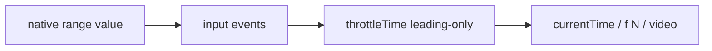

# Fix Viewer slider overshoot at start/end

## Cause

Slider `input` events are throttled in [`video-player-controls.component.ts`](lightning-pose-app/web_ui/src/app/video-player/video-player-controls/video-player-controls.component.ts) with RxJS `throttleTime`, which defaults to `{ leading: true, trailing: false }`. A rapid flick past the track fires a burst of values; only an earlier one in the ~33 ms window is written to `VideoPlayerState.currentTime`. The native `<input type="range">` is already at `min`/`max`, so the thumb looks correct while `f N`, Add-to-queue, and the `<video>` (via paused `onSeek`) stay on a nearby frame. Slow drags space events farther apart, so the error shrinks.

Frame-step `seeked` gating is not on this path. Slider seeks still go `currentTime.next` → `onSeek()`.

## Code changes

Keep logic in the controls component; do not route scrubbing through `seekToFrame` (that path is for discrete frame-step).

In [`video-player-controls.component.ts`](lightning-pose-app/web_ui/src/app/video-player/video-player-controls/video-player-controls.component.ts) / [`.html`](lightning-pose-app/web_ui/src/app/video-player/video-player-controls/video-player-controls.component.html):

1. **Always apply the last scrub value.** Replace the two leading-only throttles with one rAF `throttleTime(0, animationFrameScheduler, { leading: true, trailing: true })` (drop the extra 30 fps throttle; rAF is enough). The existing comment already guessed `trailing: true`.
2. **Commit on `change`.** Bind `(change)` as well as `(input)`. On mouseup/keyboard commit, write `rangeInput.value` to `currentTime` immediately (bypass the throttle). Once the pointer is past the end, no further `input` events fire; `change` is the event that still sees `min`/`max`.
3. **Clamp to a real frame.** When applying a slider time, clamp to `[0, lastFrame / fps]`, not `duration`. `lastFrame` is already `round(duration * fps) - 1`. Set the range `max` to that same time so the end of the track is the last frame, not `t === duration`.

Shared helper, e.g. `applySliderTime(raw: number)`, used by the throttled stream and by `change`.

## Tests

Extend [`video-player-controls.component.spec.ts`](lightning-pose-app/web_ui/src/app/video-player/video-player-controls/video-player-controls.component.spec.ts) with `fakeAsync`:

- Burst of `input` events ending at `max` / `min`; after flush, `currentFrameSignal()` is last / 0.
- `change` at `max` while `currentTime` is still mid-clip → last frame.
- Slider `max` equals `lastFrame / fps` (not full `duration` when they differ).

## Log and branch

This is a bugfix, not a feature. Do **not** add a file under `feature_plans/`.

- Add an entry to [`BUGS.md`](BUGS.md) (more detail than CHANGELOG): symptoms (thumb at end, `f N`/video nearby), cause (leading-only `throttleTime` dropping the last slider `input`), status (open → fixed on this branch).
- Branch from `origin/main`: `fix/viewer-slider-end-seek` (code + `BUGS.md` together; not a docs-only `main` edit). Do not commit or open a PR unless asked.

## Manual check

On `test_vid_with_fr`, flick the thumb past either end: thumb, picture, `f N`, and Add-current-frame must all be 0 or last frame. Slow scrub in the middle unchanged. Go-to-start / End key still work.